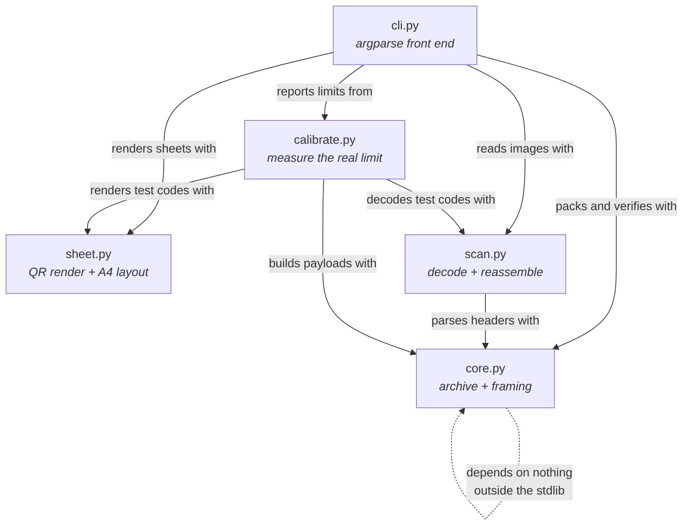

# qrpack

[](https://github.com/arsentis/qrpack/actions/workflows/ci.yml)

Pack a folder into printable QR codes, print it, photograph it, get the folder
back — verified byte for byte.

```bash
pip install -e ".[dev]"
qrpack pack ./some-folder -o sheet.png --chunk 300
qrpack restore sheet.png -o restored
diff -r ./some-folder restored      # prints nothing
```

---

## Table of Contents

- [Project Overview](#project-overview)
- [Architecture](#architecture)
- [Repository Structure](#repository-structure)
- [Dependencies and Integration](#dependencies-and-integration)
- [Command Line Reference](#command-line-reference)
- [What `calibrate` is for](#what-calibrate-is-for)
- [Measured Findings](#measured-findings)
- [Physical Print and Recovery Test](#physical-print-and-recovery-test)
- [Development Notes](#development-notes)
- [Known Issues and Limitations](#known-issues-and-limitations)
- [Additional Documentation](#additional-documentation)
- [Licence](#licence)

---

## Project Overview

### The problem

Small, high-value digital artifacts fail in ways that are hard to insure
against: disks die, accounts get locked, repositories are deleted, USB ports
are disabled. The data that hurts most when it vanishes is usually small — an
SSH key, a recovery seed, a `.env` file, a few hundred lines of source.

Paper has none of those failure modes. It needs no power, no network and no
account. Its weakness is getting the bytes back off reliably: typing a key by
hand is slow and error-prone, and OCR of base64 is worse.

QR codes solve the reading problem but introduce a size problem — a single code
holds at most a few kilobytes. So the real question is not "can I put a file in
a QR code" but: how do you split a file across many codes so an ordinary camera
can reassemble it, and so an unreadable code is detected instead of silently
corrupting the result?

### Aim

Make paper a verifiable backup medium for small digital artifacts, using only a
printer and a camera.

1. Pack any file or folder into printable sheets of QR codes.
2. Restore from an image of those sheets, with SHA-256 verification.
3. Fail specifically — name the missing part rather than produce a corrupt file.
4. Measure the real capacity of the user's own printer and scanner instead of
   quoting the QR specification.
5. Ship as a real package: tests, CI, CLI, documented findings.

### Key features

| Feature | Detail |
|---|---|
| Any file type | `tar` → `lzma` → `base64`, so arbitrary binary survives unchanged |
| Verified restore | A truncated SHA-256 travels in every code; a mismatch refuses the restore |
| Specific failure | A damaged code is reported by part number, never silently skipped |
| Multi-sheet | Codes that exceed one page produce `sheet-001.png`, `sheet-002.png`, … |
| PNG or PDF | A `.pdf` output path writes one multipage PDF instead |
| Device calibration | `qrpack calibrate` measures which chunk size survives *your* print-and-photo chain |
| Path-traversal safe | Archive members are validated before a single byte is written |

### Likely use cases

- **Key and credential backup** — SSH or GPG keys, recovery seeds, `.env` files
  printed and kept offline, immune to ransomware and account lockout.
- **Air-gapped transfer** — move data to a machine with no network and no USB;
  a screen and a camera are enough.
- **Archival of small source** — paper stays readable for decades; a URL may not
  resolve in five years.
- **Teaching** — compression, chunking, error correction and checksums made
  physically demonstrable.

---

## Architecture

### Technology stack

| Layer | Choice | Why |
|---|---|---|
| Language | Python ≥ 3.10 | CI covers 3.10, 3.11, 3.12 |
| QR encoding | [`segno`](https://pypi.org/project/segno/) | Pure Python, exposes version and ECC directly |
| Raster layout | [`Pillow`](https://pypi.org/project/pillow/) | A4 page composition, PNG and PDF output |
| QR decoding | [`opencv-python-headless`](https://pypi.org/project/opencv-python-headless/) | `QRCodeDetector` and `QRCodeDetectorAruco` |
| Archiving | stdlib `tarfile`, `lzma`, `base64`, `hashlib` | No third-party code in the data path |

### The pipeline

```mermaid
flowchart LR
    subgraph write["Writing a backup"]
        A["folder or file"] -->|"pack_bytes()"| B["deterministic tar"]
        B -->|"compress()"| C["lzma blob"]
        C -->|"chunk()"| D["QRPK1 payloads<br/>header + base64"]
        D -->|"render_codes()<br/>make_sheet()"| E["A4 sheet<br/>PNG or PDF"]
        E -->|"printer"| F["paper"]
    end

    subgraph read["Reading it back"]
        F -->|"camera or scanner"| G["image file"]
        G -->|"scan_image()"| H["decoded payloads"]
        H -->|"reassemble()"| I["lzma blob<br/>+ missing part list"]
        I -->|"verify_digest()"| J["sha256 checked"]
        J -->|"decompress()<br/>unpack_bytes()"| K["original folder"]
    end
```



### Module relationships



`core.py` deliberately imports no third-party package: the data path that
decides whether your bytes come back is stdlib-only.

### The payload format

Every QR code carries one self-describing ASCII line, frozen before
implementation started and never changed since:

```
QRPK1|<sha256-first-16>|<index>/<total>|<base64 chunk>
```

| Field | Role |
|---|---|
| `QRPK1` | Magic, so a foreign QR code on the same page is ignored |
| `sha256-first-16` | Truncated digest of the whole blob; detects corruption, not tampering |
| `index/total` | Lets a half-scanned sheet say *which* parts are still missing |
| base64 chunk | The data, ASCII-safe so arbitrary binary survives |

The header is human-readable on purpose: the part numbers are the difference
between "rescan page 2" and "your backup is gone".

### Key design patterns

- **Validate before writing.** `make_sheet` builds every symbol before creating
  a file, and `unpack_bytes` checks every archive member before extracting, so a
  failure never leaves a partial artifact behind.
- **Fail loudly, exit non-zero.** A backup tool that exits `0` without writing
  anything is worse than one that crashes. Every failure path returns a message
  naming the cause instead of a traceback.
- **Deterministic archives.** Entries are sorted and mtime/uid/gid/mode are
  zeroed, so the same folder always produces the same bytes — without this the
  printed digest would differ per machine and verify nothing.
- **Uniform cells.** Codes of different QR versions are padded to one square
  size, because the scanner locates cells by grid arithmetic.
- **Measure, don't quote.** Every number in this README has a command that
  reproduces it.

---

## Repository Structure

```
qrpack/
├── qrpack/
│   ├── core.py          archiving (tar, lzma) + framing (Header, chunk, sha256)
│   ├── sheet.py         QR rendering, uniform cells, A4 layout, PNG/PDF output
│   ├── scan.py          image → payloads, reassembly, missing-part reporting
│   ├── calibrate.py     ECC cost table, degradation sweep, chunk recommendation
│   └── cli.py           estimate / pack / restore / calibrate subcommands
├── tests/
│   ├── test_*.py        192 tests
│   ├── measure_*.py     scripts that regenerate the numbers in this README
│   └── capture_usage.sh regenerates the command transcripts below
├── .github/workflows/ci.yml   pytest on Python 3.10, 3.11, 3.12
├── CONTRIBUTING.md      setup, conventions and review process
└── docs/images/         photographs from the physical print-and-recovery test
```

| File | Role |
|---|---|
| `qrpack/core.py` | The data path. Stdlib only, so nothing third-party can corrupt a restore |
| `qrpack/sheet.py` | A4 geometry at 300 DPI (2480 × 3508 px) and all page furniture |
| `qrpack/scan.py` | Two OpenCV detectors plus a scale sweep, because one call is unreliable |
| `qrpack/calibrate.py` | Reports the resolution limit across chunk sizes, rather than assuming one |
| `tests/measure_*.py` | Not tests — reproducible measurement scripts cited by this README |

---

## Dependencies and Integration

qrpack is a **self-contained command-line tool**. It makes no network calls,
needs no services, databases, message queues or event streams, and reads and
writes only the paths you give it.

The physical dependencies are the ones worth planning for:

| Dependency | Needed for | Note |
|---|---|---|
| A printer | Producing paper | Resolution sets the real chunk ceiling; use `qrpack calibrate` |
| A camera or scanner | Reading paper back | A smartphone photo has been verified to work |

---

## Command Line Reference

```bash
qrpack estimate SRC              # how many codes and sheets would this take?
qrpack pack SRC -o sheet.png     # folder -> printable sheet(s)
qrpack restore IMG... -o DIR     # sheet image(s) -> original files
qrpack calibrate                 # measure which chunk size survives, recommend one
```

| Command | Arguments | Options |
|---|---|---|
| `estimate` | `SRC` file or folder | `--chunk BYTES` (default 1200) |
| `pack` | `SRC` file or folder | `-o/--output OUT`, `--chunk BYTES`, `--cols N` (default 3) |
| `restore` | `IMG...` one or more sheet images, any order | `-o/--output DIR`, `--cols N` |
| `calibrate` | — | `--ecc l\|m\|q\|h`, `--printed-px PX`, `--blur RADIUS`, `--jpeg-quality Q` |

Exit status is `0` on success and non-zero on any failure, so a script can never
mistake a failed run for a backup that was written.

### Every transcript below is real

They come from one run of `bash tests/capture_usage.sh` on a folder of three
small files (Markdown, an SSH public key, 400 random bytes). Re-run that script
after changing the CLI: if its output stops matching this section, this section
is wrong.

#### estimate — how much paper will this take?

```
$ qrpack estimate notes
10240 B raw -> 692 B compressed -> 951 chars encoded -> 1 codes
exit 0

$ qrpack estimate notes --chunk 300
10240 B raw -> 692 B compressed -> 1005 chars encoded -> 3 codes
exit 0
```

Two things visible here that are easy to get wrong. The 10,240 B is the *tar*,
not the files: a tar pads every entry to a 512-byte record, which is why three
small files become ten kilobytes and why compressing before chunking is not an
optimisation but the thing that makes the idea work at all. And the encoded
length grows from 951 to 1,005 characters when the chunk size shrinks, because
each code carries its own `QRPK1|digest|i/n|` header — more codes means more
headers.

#### pack — folder to printable sheet

```
$ qrpack pack notes -o sheet.png --chunk 300
3 codes on 1 page(s) -> sheet.png
exit 0

$ ls
  notes
  sheet.png
```

#### restore — sheet back to folder

```
$ qrpack restore sheet.png -o restored
restored 3 file(s) -> restored
exit 0

$ diff -r notes restored
  (no output: the restored files are byte identical)
```

That silent `diff` is the entire project in one line: the bytes that came off
the image are the bytes that went onto it.

#### calibrate — what survives on this machine

```
$ qrpack calibrate
payload  ver  modules  px/module  decodes
   100 B  v9        61       7.74  PASS
   300 B  v16       89       5.30  PASS
   600 B  v23      117       4.03  PASS
   900 B  v29      141       3.35  PASS
  1200 B  v33      157       3.01  fail
  1500 B  v38      177       2.67  fail

recommended --chunk : 900
```

#### Failures are loud

```
$ qrpack pack does-not-exist -o x.png
qrpack pack: does-not-exist does not exist
exit 1

$ qrpack restore blank.png -o out2
qrpack restore: no qrpack codes found in the image(s)
exit 1
```

---

## What `calibrate` is for

A QR code is a grid of modules — the small black squares. Putting more bytes in a
code means more modules squeezed into the same printed square, so each module
gets fewer pixels when a camera looks at it. Past a point the camera can no
longer tell the modules apart and the code is dead paper.

**Capacity is never what fails first; resolution is.** The QR standard says a
version 40 code holds 2,331 bytes at ECC M, and that number is useless on its
own, because a 2,331-byte code printed at 40 mm is unreadable by an ordinary
camera long before the standard runs out of room.

`qrpack calibrate` renders codes across a ladder of payload sizes, puts each one
through a print-and-photograph model — downscale to a fixed physical size,
optional blur, optional JPEG compression — and reports which still decode:

```
payload  ver  modules  px/module  decodes
   300 B   13       69       6.84   PASS
   600 B   20       97       4.87   PASS
   900 B   25      117       4.03   PASS
  1200 B   29      133       3.55   fail
```

One number explains every row: **pixels per module**. Below roughly 3.5 the
decoder gives up. That is the whole mechanism, and it is why `--chunk` is a knob
worth measuring rather than a constant worth guessing.

What `calibrate` does *not* do is read your printer's specifications — it models
the chain rather than inspecting your hardware, and the model's physical size is
a parameter you pass. For a device-specific answer, print a sheet and photograph
it, as in [the physical test below](#physical-print-and-recovery-test).

---

## Measured Findings

Every number below was produced by a script in `tests/`, named under each table.
Results marked *on this machine* depend on the OpenCV build, the printer and the
camera; the ECC geometry table follows from the QR specification and is the same
everywhere.

Measurements were taken with OpenCV `5.1.0` (`python -c "import cv2; print(cv2.__version__)"`).

### Detector choice matters more than scale

A sheet of three codes (payloads of 1363, 1363 and 775 characters), decoded with
each OpenCV detector across a range of image scales:

| Detector | Scale | Decoded |
|---|---|---|
| `QRCodeDetector` | 0.5–3.0 | 0/3 |
| `QRCodeDetectorAruco` | 0.5 | 0/3 |
| `QRCodeDetectorAruco` | 0.75–3.0 | 3/3 |

The same codes decoded directly, by error-correction level:

| ECC | QR version | Scale 4 | Scale 6 | Scale 8 |
|---|---:|---|---|---|
| L | 26 | FAIL | PASS | PASS |
| M | 30 | FAIL | FAIL | FAIL |
| Q | 37 | FAIL | FAIL | FAIL |

…and with `QRCodeDetectorAruco`:

| ECC | QR version | Scale 4 | Scale 6 | Scale 8 |
|---|---:|---|---|---|
| L | 26 | PASS | PASS | PASS |
| M | 30 | PASS | PASS | PASS |
| Q | 37 | PASS | PASS | PASS |

This is why `scan.py` tries both detectors across a scale ladder instead of
trusting one call. Reproduce: `python3 tests/measure_scan_decoders.py`

### Raising error correction can make a printed code *less* readable

For one realistic payload (1227 characters: a header plus a 1,200-byte base64
chunk) in a 40 mm cell at 300 DPI (472 px):

| ECC | Version | Modules | px/module |
|---|---:|---:|---:|
| l | 25 | 125 | 3.78 |
| m | 29 | 141 | 3.35 |
| q | 34 | 161 | 2.93 |
| h | 40 | 185 | 2.55 |

`h` recovers the most damage but needs 1.48× the modules of `l`, so each module
gets smaller in the same printed square — down to 2.55 px/module. In the sweep
below a code at 3.01 px/module already failed on this machine, so `h` is not
usable at this printed size. This is the counter-intuitive result that motivates
calibration: the standard's capacity is not the number that fails first.

Reproduce: `python3 tests/measure_ecc_cost.py`

### Where decoding actually fails

Each code is rendered, resized to one fixed square of 472 px, optionally
blurred, and decoded. Every code gets the *same printed size*, because on paper
every cell occupies the same square — a denser symbol simply gets fewer pixels
per module. Scaling each code by the same fraction instead would make large
codes look better than they are.

| Chunk (B) | Payload (chars) | Version | Modules | px/module | Clean | Blur 2 |
|---:|---:|---:|---:|---:|---|---|
| 100 | 163 | 9 | 61 | 7.74 | pass | pass |
| 300 | 427 | 16 | 89 | 5.30 | pass | FAIL |
| 600 | 827 | 23 | 117 | 4.03 | pass | FAIL |
| 900 | 1227 | 29 | 141 | 3.35 | pass | FAIL |
| 1200 | 1627 | 33 | 157 | 3.01 | FAIL | FAIL |
| 1500 | 2027 | 38 | 177 | 2.67 | FAIL | FAIL |

The pass/fail edge comes from the decoder, not only from px/module, so these
rows are measurements rather than a rule.

Reproduce: `qrpack calibrate`

### A damaged sheet names the lost part

One code on a five-part sheet was painted black before scanning, the way a stain
or a folded corner would destroy one code on real paper:

```
parts rendered    : 5
part blacked out  : 3
parts decoded     : [1, 2, 4, 5]
reassemble        : missing=[3] blob_empty=True digest=f7dbe72bcc439d2d
cli restore       : rc=1 | qrpack restore: missing parts [3]; rescan them and pass every sheet
files written     : 0
with intact copy  : rc=0 bytes_identical=True
```

The scan recovered four of five codes, `reassemble` named part 3 and returned an
empty blob, so the restore exited non-zero and wrote **no files** — it did not
hand back a corrupt backup. Adding one intact copy of the same sheet supplied
the missing part and the original came back byte for byte.

Reproduce: `python3 tests/measure_damaged_sheet.py`

### Excluding build junk halves the printout

Packing this repository with and without a typical set of generated directories
(`__pycache__`, `node_modules`, `.venv`, `.git`):

| | Compressed | QR codes | A4 sheets |
|---|---:|---:|---:|
| with junk | 57,052 B | 64 | 6 |
| without junk | 25,480 B | 29 | 3 |

Reproduce: `python3 tests/measure_archive_rules.py`

---

## Physical Print and Recovery Test

To verify that qrpack works beyond digital QR generation, the workflow was run
end to end on paper with an ordinary printer and a smartphone.

### Procedure

1. Created a sample `.txt` file containing test data.
2. Generated a printable QR sheet with `qrpack pack`.
3. Printed the sheet on paper.
4. Scanned the printed code with a smartphone and decoded its contents.
5. Photographed the printed sheet and transferred the image to a computer.
6. Restored the original file from the photograph with `qrpack restore`.
7. Verified the recovered file matched the original.

### Results

| Test | Result |
|---|---|
| QR sheet generation | PASS |
| Physical printing | PASS |
| Smartphone QR scanning | PASS |
| Payload decoding | PASS |
| File restoration from photograph | PASS |
| Original file content verification | PASS |

Photograph restored successfully at 340 KB; generated sheet 45 KB; chunk size
1,200 bytes. Photographs from the run are in [`docs/images/`](docs/images):

| Image | Shows |
|---|---|
| [`original-file.jpg`](docs/images/original-file.jpg) | the source text file before packing |
| [`printed-sheet.jpg`](docs/images/printed-sheet.jpg) | the generated QR sheet, printed |
| [`print-setup.jpg`](docs/images/print-setup.jpg) | the printer and working setup |
| [`phone-capture.jpg`](docs/images/phone-capture.jpg) | capturing the printed sheet with a phone |

### Conclusion

```
original file → QR sheet → printed paper → smartphone photograph → restored file
```

The full chain works without specialised scanning equipment. This test used a
small text file; larger files, multiple pages, other print resolutions and
varied lighting remain untested.

---

## Development Notes

```bash
python3 -m venv .venv && source .venv/bin/activate
pip install -e ".[dev]"
python -m pytest -q        # 192 passed
qrpack --help              # the console script is installed
```

CI runs the suite on Python 3.10, 3.11 and 3.12 for every pull request.

### Conventions

- **`tests/measure_*.py` are not tests.** They are measurement scripts whose
  output is quoted in this README. Re-run them after changing behaviour.
- **`tests/test_readme_usage.py` guards the documentation.** It re-runs the
  documented commands and fails if their output stops matching this file, so a
  stale README breaks the build rather than misleading a reader.
- **Numbers need a command.** Any figure added here should name the script that
  reproduces it.
- See [`CONTRIBUTING.md`](CONTRIBUTING.md) for branch naming, commit style and
  the definition of done.

### Performance considerations

Rendering is the slow half: roughly 20 codes per second, so a 231 KB JPEG
(770 codes, 65 sheets at 12 per page) takes about 18 seconds to pack and 7
seconds to restore.
Cost scales with *compressed* size, so the practical ceiling is a few hundred
kilobytes — see the limitations below.

---

## Known Issues and Limitations

- **No redundancy across codes.** One unreadable code makes the whole archive
  unrestorable; qrpack reports which part is missing but cannot reconstruct it.
  Cross-code erasure coding (any *k* of *n*) is the single most valuable
  improvement still outstanding.
- **Already-compressed files barely shrink.** A `.docx`, `.jpg`, `.pptx` or
  `.zip` is internally compressed, so `lzma` gains ~5% and base64 then adds 33%.
  A 3 MB PowerPoint needs roughly 2,380 codes — about 199 A4 sheets. Correct,
  but not practical. qrpack suits small high-value artifacts.
- **Decoder reliability is not monotonic.** A given symbol may fail at one image
  scale and succeed at another; `scan.py` compensates with a scale sweep and two
  detectors, but the behaviour is an OpenCV property, not something qrpack can
  fix.
- **The default chunk size is larger than this machine's measured limit.** The
  CLI defaults to 1,200 B while `calibrate` recommends 900 B here. The default is
  deliberately left as a documented starting point rather than tuned to one
  machine — run `qrpack calibrate` and pass `--chunk`.
- **Photo handling is minimal.** Images are expected to be reasonably flat and
  square-on; there is no perspective correction or deskew, so a sharply angled
  photograph may not decode.
- **Page furniture is fixed.** A4 at 300 DPI with constant margins, header and
  footer; neither is configurable from the CLI.
- **`calibrate` simulates print and photo** by resizing, blurring and JPEG
  compression. It is a model of a print-and-scan chain, not a substitute for the
  physical test above.

---

## Additional Documentation

- [`CONTRIBUTING.md`](CONTRIBUTING.md) — setup, code conventions, testing
  requirements and the review process.

### How qrpack differs

Paper backup is an established idea. These are the things that were not found in
the comparable tools, each with the section of this README that evidences it:

| | Detail |
|---|---|
| **Reports the resolution limit instead of assuming one** | Every comparable tool ships a fixed chunk size chosen by its author. `qrpack calibrate` measures where decoding fails and explains it in pixels per module — see [What `calibrate` is for](#what-calibrate-is-for) |
| **More error correction can make a printed code less readable** | At a fixed 40 mm cell, ECC `l` gives 3.78 px/module and ECC `h` only 2.55, because `h` needs 1.48× the modules. The standard's safest setting is the least recoverable one on paper — see [ECC cost](#raising-error-correction-can-make-a-printed-code-less-readable) |
| **Detector choice matters more than image scale** | On the same sheet, OpenCV's `QRCodeDetector` decoded 0 of 3 codes at every scale tried while `QRCodeDetectorAruco` decoded 3 of 3. `scan.py` therefore tries both across a scale ladder — see [Detector choice](#detector-choice-matters-more-than-scale) |
| **Damage is reported by part number, and nothing is written** | A code destroyed on the sheet produces `missing parts [3]`, exit status 1 and zero files, rather than a silently truncated archive — see [A damaged sheet names the lost part](#a-damaged-sheet-names-the-lost-part) |
| **Archives are byte-deterministic** | Entries are sorted and metadata zeroed, so the same folder yields the same digest on any machine. Without this the digest printed on the paper would verify nothing |
| **The documentation cannot rot** | `tests/test_readme_usage.py` re-runs the commands shown here and fails the build if their output stops matching, so a stale README breaks CI instead of misleading a reader |
| **Any file type, verified** | `tar` → `lzma` → `base64` means arbitrary binary survives; JPEG, `.docx` and random bytes have each been restored byte-identically |

And the honest counterweight: qrpack has **no redundancy across codes**. One
unreadable code makes the archive unrestorable, where `qr-backup` tolerates
losing up to 30% of its codes. It is also the least dense of the three.

| Project | Approach | Density |
|---|---|---|
| [`za3k/qr-backup`](https://github.com/za3k/qr-backup) | QR codes, Reed–Solomon redundancy, restores without the tool installed | 3 KB/page default, up to 130 KB/page |
| [Twibright Optar](http://ronja.twibright.com/optar) | Custom 2D barcode with Golay error correction | ~200 KB/page |
| [`cyphar/paperback`](https://github.com/cyphar/paperback) | Encrypted backup split into Shamir key shards | — |
| qrpack | QR codes, device calibration, measured findings | ~14 KB/page at default settings |

`qr-backup` is more mature and far denser, and Optar is denser still. What has
not been found elsewhere is a tool that *measures the limit of the printer and
camera in front of you* instead of shipping fixed presets — which the ECC table
above shows matters, because the specification's capacity is not the number that
fails first.

---

## Licence

MIT. See [`LICENSE`](LICENSE).
